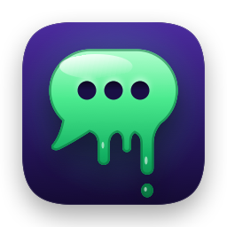
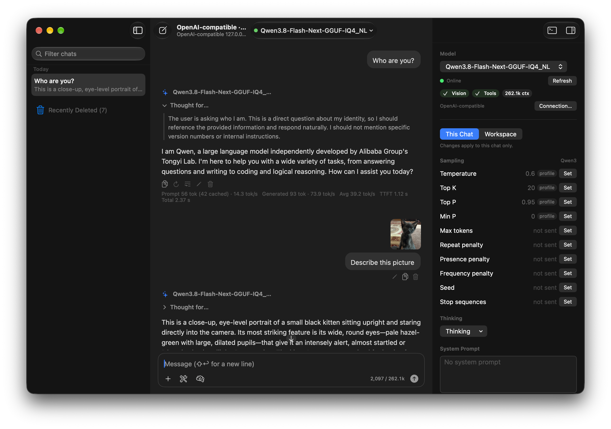
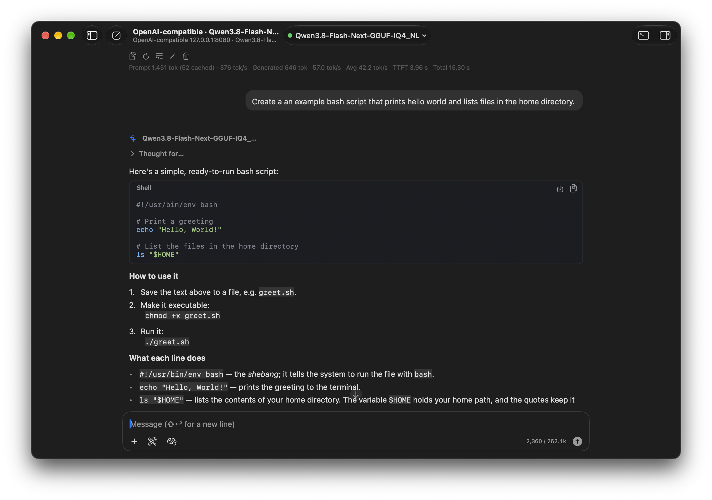
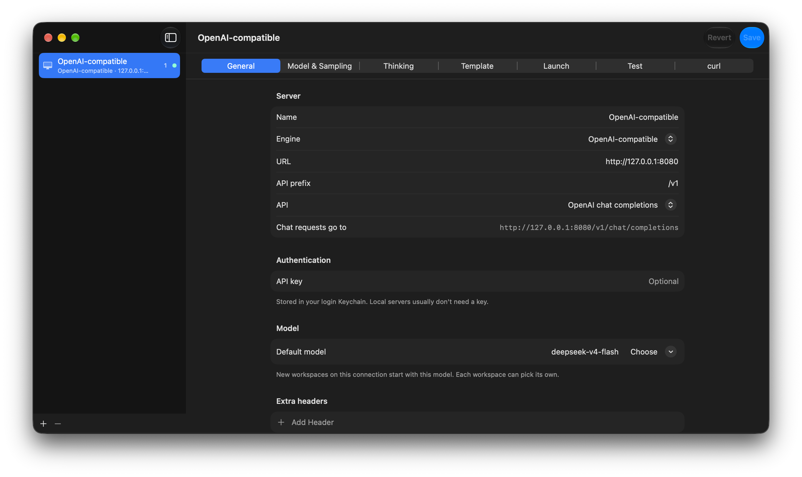
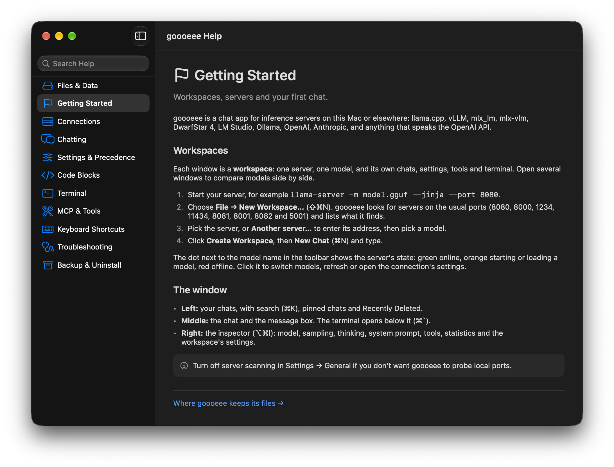
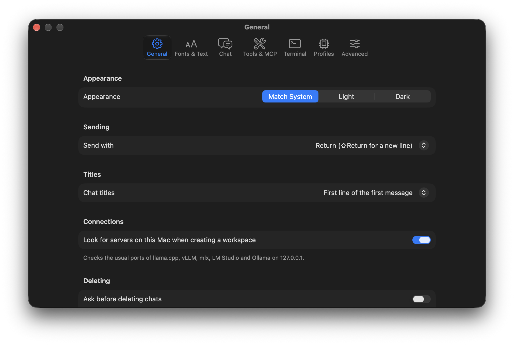

<p align="center">
  
</p>

# goooeee

goooeee is a native macOS chat application for large language models (LLMs). The name is a play on "GUI" (graphical user interface).

goooeee connects to inference servers on your Mac or on a network. It does not run models. The server runs the model.

## Screenshots

**1. Workspace window.** The left column shows the chats. The middle column shows a chat with model thinking and an image question. The right column shows the inspector.



**2. Chat with a code block.** The reply contains Markdown and a shell script. The code block has the Save As and Copy buttons.



**3. Connections window.** One connection is one server. The tabs contain the server address, the model, sampling, thinking, template, launch command, test and curl commands.



**4. Help window.** The Help window shows topics, file locations and keyboard shortcuts.



**5. Settings window.** The settings apply to all windows.



## Functions

### Servers

goooeee uses these server types:

| Server type | API that goooeee uses |
|---|---|
| llama.cpp | OpenAI chat completions, plus `/props`, `/health`, server tools and model routing |
| vLLM | OpenAI chat completions |
| mlx_lm, mlx-vlm | OpenAI chat completions |
| DwarfStar 4 | OpenAI chat completions |
| LM Studio | OpenAI chat completions |
| Ollama | OpenAI chat completions |
| OpenAI | OpenAI chat completions |
| Anthropic | Anthropic Messages API |
| Other servers | OpenAI chat completions (the default for all other servers) |

When you make a new workspace, goooeee looks for servers on ports 8080, 8000, 1234, 11434, 8081, 8001, 8082 and 5001 of your Mac. You can disable this function in Settings.

### Workspaces

- One window is one workspace.
- A workspace has one server, one model, its chats, its settings, its tools and its terminal.
- You can open many workspaces at the same time.

### Chat

- The chat shows replies as they arrive (streaming).
- The chat shows Markdown, tables, code with syntax colors, and math (LaTeX).
- The chat shows model thinking (reasoning) in a block that you can open and close.
- Each reply shows the prompt speed, the generation speed, the token counts and the time.
- You can edit messages, regenerate replies and continue replies. goooeee keeps the old versions as branches.
- You can attach images, PDF files and text files. You can paste an image from the clipboard.
- goooeee sends images only to models that accept images.
- goooeee keeps deleted chats in Recently Deleted for 30 days. You can change this time in Settings.
- Search (⌘K) finds text in the chats of the workspace or of all workspaces.

### Code blocks

- **Copy** copies the code.
- **Save As** saves the code to a file. goooeee finds the file name in the reply (for example, "save this as `hello.sh`").
- **Paste into Terminal** puts a shell command into the terminal of the workspace. The command does not start until you push Return.
- **Preview** shows HTML and SVG code in a window.

### Settings for the model

- The inspector shows the model, the server status, vision and tool support, and the context size.
- You can set sampling values (temperature, top-p and others) for one chat, for a workspace or for a connection.
- goooeee contains model profiles with the recommended values from the model cards.
- The first level that has a value supplies the value: chat, workspace, connection, model profile, server default.
- A label next to each value shows the source of the value.

### Tools (MCP)

- goooeee connects to Model Context Protocol (MCP) servers through stdio, HTTP or SSE.
- The model can call tools from these servers. goooeee asks for your permission before each call.
- You can give permission one time, or always for a tool or for a server.
- You can use MCP prompts (type `/`) and MCP resources (type `@`) in the message box.
- goooeee can import and export MCP server lists in the `mcpServers` JSON format.

### Connections

- A connection contains the server address, the API key, the default model and the default settings.
- The **Test** tab does a check of the server, the API key, the model list, the capabilities and a short reply. It can also send a test image and request a tool call.
- The **curl** tab shows curl commands for the same requests that goooeee sends.

### Terminal

- Each workspace has a terminal (⌘`) with your login shell.
- A connection can have a launch command. **Start Server** runs this command in the terminal.

### Help

Help → goooeee Help (⌘?) shows the documentation in the application. The **Files & Data** topic shows all locations where goooeee keeps data.

## Data locations

goooeee is not sandboxed. It installs no helper programs, login items, command-line tools or system extensions.

| Data | Location |
|---|---|
| Chats, workspaces, connections, MCP servers, profiles, tool permissions | `~/Library/Application Support/goooeee/goooeee.sqlite` |
| Settings | `~/Library/Preferences/local.goooeee.app.plist` |
| API keys and MCP secrets | Login keychain, item name `goooeee` |
| Network cache | `~/Library/Caches/local.goooeee.app` |
| Crash reports | `~/Library/Logs/DiagnosticReports/goooeee-*.ips` |

goooeee does not keep API keys in the database or in the settings file. goooeee has no analytics. goooeee sends your messages only to the server of the workspace.

## Requirements

- macOS 26 or later
- Xcode 26 or later
- An internet connection for the first build. Xcode downloads the Swift packages.
- [XcodeGen](https://github.com/yonaskolb/XcodeGen), only if you add, move or remove source files

The application was built and tested on macOS 27.0.1 with Xcode 27.0 and Swift 6.4.

## Build on macOS

### Build with the script

1. Open Terminal.
2. Clone the repository:

   ```sh
   git clone https://github.com/alex0com/goooeee.git
   cd goooeee
   ```

3. Run the build script:

   ```sh
   Tools/build-dmg.sh
   ```

4. Open `build/goooeee.app`, or open the disk image `build/goooeee-<version>.dmg`.

The script builds the Release configuration. It also makes the disk image and shows the UUID of each binary. Use these options when necessary:

| Option | Function |
|---|---|
| `--test` | Runs the package tests before the build |
| `--debug` | Builds the Debug configuration |
| `--clean` | Deletes the `build/` folder before the build |
| `--help` | Shows the options |

### Build with Xcode

1. Open `goooeee.xcodeproj` in Xcode.
2. Wait until Xcode resolves the Swift packages.
3. Select the **goooeee** scheme.
4. Push ⌘R.
5. When Xcode asks about the SwiftTerm build plugin, click **Trust & Enable**.

The SwiftTerm plugin only writes the version of SwiftTerm into a source file.

### Build with xcodebuild

```sh
xcodebuild -project goooeee.xcodeproj -scheme goooeee -configuration Release \
  -skipPackagePluginValidation build
```

The `-skipPackagePluginValidation` option is necessary for the SwiftTerm plugin.

### Signing

The default build has an ad hoc signature and the bundle ID `local.goooeee.app`. You do not need an Apple developer account. To use your bundle ID and team, do these steps:

1. Copy the example file:

   ```sh
   cp Config/Local.xcconfig.example Config/Local.xcconfig
   ```

2. Edit `PRODUCT_BUNDLE_IDENTIFIER`, `DEVELOPMENT_TEAM`, `CODE_SIGN_STYLE` and `CODE_SIGN_IDENTITY` in `Config/Local.xcconfig`.

Git ignores `Config/Local.xcconfig`. With an ad hoc signature, macOS can ask for keychain access again after each build. Click **Always Allow**.

### Project file

The repository contains `goooeee.xcodeproj`. `project.yml` is the source of the project file. After you add, move or remove source files, generate the project again:

```sh
xcodegen generate
```

`Tools/build-dmg.sh` does this step automatically when it is necessary.

### Application icon

`Tools/make-icon.swift` draws the icon and writes all sizes into the asset catalog:

```sh
swift Tools/make-icon.swift
```

## Tests

The `GoooeeeKit` package contains the tests. They use Swift Testing.

```sh
cd Packages/GoooeeeKit
swift test
```

Some tests start the mock servers in `Tools/MockServer` and `Tools/MockMCP`. These mock servers need Python 3. You can also use the mock servers to try the application without a model:

```sh
python3 Tools/MockServer/mock_server.py --engine llamacpp --port 8080 --vision --tps 80
```

## Project structure

| Folder | Contents |
|---|---|
| `App/` | The macOS application: SwiftUI windows and the AppKit transcript |
| `Packages/GoooeeeKit/` | Swift package with the application logic and the tests |
| `Packages/GoooeeeKit/Sources/GoooeeeCore` | Server APIs, streaming, settings, the database, the chat engine |
| `Packages/GoooeeeKit/Sources/GoooeeeMarkdown` | Markdown parser, syntax highlighter, code block file names |
| `Packages/GoooeeeKit/Sources/GoooeeeMCP` | MCP client and transports |
| `Packages/GoooeeeKit/Sources/GoooeeeTranscript` | Rows of the chat transcript |
| `Config/` | Build settings (`.xcconfig` files) |
| `Tools/` | Build script, icon script, mock servers |
| `docs/` | Design plan (`PLAN.md`) |
| `screenshots/` | Screenshots for this file |

## Acknowledgements

### Source code

Claude, an AI model from Anthropic, wrote the source code of goooeee. [alex0com](https://github.com/alex0com) directed the work and tested the application. The Git history shows each change.

The repository does not contain code from other projects. Swift Package Manager downloads the packages below during the build.

### Packages

goooeee uses these packages:

| Package | Use in goooeee | License |
|---|---|---|
| [GRDB.swift](https://github.com/groue/GRDB.swift) | SQLite database | MIT |
| [swift-markdown](https://github.com/swiftlang/swift-markdown) | Markdown parser | Apache 2.0 |
| [swift-cmark](https://github.com/swiftlang/swift-cmark) | Markdown parser (used by swift-markdown) | BSD 2-Clause |
| [MCP Swift SDK](https://github.com/modelcontextprotocol/swift-sdk) | MCP client | MIT and Apache 2.0 (the project changes from MIT to Apache 2.0) |
| [swift-jinja](https://github.com/huggingface/swift-jinja) | Chat templates | Apache 2.0 |
| [SwiftTerm](https://github.com/migueldeicaza/SwiftTerm) | Terminal | MIT (contains code from xterm.js) |
| [SwiftMath](https://github.com/mgriebling/SwiftMath) | Math (LaTeX) | MIT (a Swift translation of iosMath) |
| [swift-log](https://github.com/apple/swift-log) | Log messages | Apache 2.0 |

These packages are indirect dependencies:

| Package | Required by | License |
|---|---|---|
| [EventSource](https://github.com/mattt/eventsource) | MCP Swift SDK | MIT |
| [swift-nio](https://github.com/apple/swift-nio) | MCP Swift SDK | Apache 2.0 |
| [swift-system](https://github.com/apple/swift-system) | MCP Swift SDK | Apache 2.0 |
| [swift-atomics](https://github.com/apple/swift-atomics) | swift-nio | Apache 2.0 |
| [swift-collections](https://github.com/apple/swift-collections) | swift-jinja, swift-nio | Apache 2.0 |
| [swift-argument-parser](https://github.com/apple/swift-argument-parser) | SwiftTerm (its tools, not the library) | Apache 2.0 |

Each package keeps its license. The license files are in the package repositories.

### Other sources

- The functions of goooeee follow the [llama.cpp](https://github.com/ggml-org/llama.cpp) web UI. goooeee uses the ideas, not the code.
- The values in the model profiles come from the model cards and documents of each model. Each profile in `model-profiles.json` names its source.

## License

goooeee has the MIT License. See [LICENSE](LICENSE). You can use, copy, change and distribute goooeee for all purposes.
